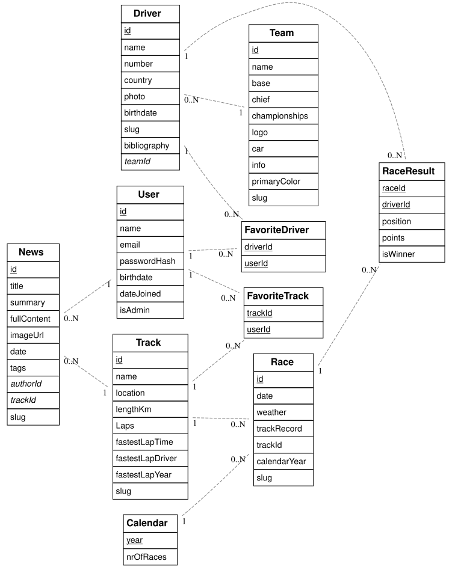

# Dossier

> **Instructies:**
>
> - Vul dit dossier volledig in en zorg ervoor dat alle links correct zijn
> - In het geval je slechts één olod volgt, verwijder alle inhoud omtrent het andere olod uit dit document
> - Lees [Markdown Cheatsheet](https://github.com/adam-p/markdown-here/wiki/Markdown-Cheatsheet) om te weten hoe een Markdown-bestand opgemaakt moet worden
> - Verwijder alle instructies (lijnen die starten met >) wanneer je klaar bent

## 📋 Studentgegevens

- **Student:** Elias Bloem, Brian De Sadeleer
- **Studentennummer:** 202404402
- **E-mailadres:** elias.bloem@student.hogent.be, brian.desadeleer@student.hogent.be
- **GitHub repository:** git@github.com:HOGENT-frontendweb/frontendweb-2526-bloemdesadeleer.git
- **Online versies:**
  - **Back-end:** <> 
  - **Front-end:** <"http://localhost:5173>
- **Demo:** <LINK_NAAR_DEMO_VIDEO>

## 🔐 Logingegevens

> **Instructies:**
>
> - Vul de logingegevens in voor test accounts.
> - Zorg ervoor dat deze accounts representatieve data bevatten.
> - Voeg hieronder eventueel extra accounts toe voor administrators of andere rollen.

### Lokale omgeving

- **E-mailadres**: <admin@f1site.com>
- **Wachtwoord**: testpassword
- **Rol**: admin

### Online omgeving

- **E-mailadres**: <fan@f1site.com>
- **Wachtwoord**: testpassword2
- **Rol**: user

## 📖 Projectbeschrijving

Onze site is bedoeld voor mensen, jong en oud, die graag op een simpele manier kennis willen maken met Formule 1. De belangrijkste aspecten zoals de coureurs, de teams, de banen, de races zijn hier allemaal te bekijken met wat extra informatie. Je kan ook nog een tal van extra's doen zoals je favoriete coureur of baan aanduiden. Je kan op een simpele manier moeiteloos overal naartoe navigeren en op jouw profiel pagina krijg je dan jouw informatie te zien en ook wie jouw favoriete courours en/of banen zijn. 

- Driver geeft ons alle aspecten dat een driver definieert id, die is het belangrijkste omdat we die gebruiken voor de relaties met andere entiteiten, waarbij de twee belangrijkste FavoriteDriver (voor je favo driver te kunnen aanduiden) en Teams (om te weten in welk team deze driver zit). Al de andere zijn meer algemene attributen, zoals name, birthdate, country, etc... . 
- TeamId legt nog de link tussen de driver en zijn team, die dus gebruikt wordt voor de relatie tussen driver en team. Dan weer wat algemene zoals, name, base, teamChief, ChampionShips.
- Track is bijna hetzelfde als de driver met opnieuw een trackId die we gebruiken in de relaties met FavoriteTrack (voor je favoriete track te kunnen aanduiden) en als ook met news (Waar de gebeurtenis zich heeft voor gedaan) en als laatste nog met races (voor te weten op welke track de race gereden zal worden)
- Race definieert dan wat die inhoud, daar heb je raceId die de relaties legt met ... . Weer wat algemen attributen die je heel wat extra informatie geven over de race zoals date, weather, trackRecord
- News geeft ons weer wat een artikel allemaal inhoud, uiteraard weer een id die we gebruiken in de relaties met Track en User. Met user is er een relatie omdat een user een artikel kan schrijven. Vandaar komt de AuthorId. Opnieuw heel wat algemene attributen zoals, summary, fullcontent, title, etc... .
- Calender geeft ons year en nrOfRaces en deze geven weer hoeveel races elk jaar plaatsvinden. Deze heeft dan een relatie met Race, omdat we die gebruiken om te weten wanneer een bepaalde race plaatsvind. Year is hier de primary key, omdat deze de races uniek maakt.

## ✅ Ontvankelijkheidscriteria

- [ ] Het project van Web Services voldoet aan **alle** ontvankelijkheidscriteria zoals beschreven in de rubrics.
- [ ] Het project van Front-end Web Development voldoet aan **alle** ontvankelijkheidscriteria zoals beschreven in de rubrics.

## 🚀 Extra technologieën

> **Instructie:** Beschrijf welke extra technologieën je hebt gebruikt. Vermeld waarom je deze hebt gekozen.
- We hebben in onze homepage een carrousel toegevoegd voor de coureurs te bekijken. Dit geeft een heel cool effect, omdat het lijkt alsof ze in een rondje bewegen als je er in doorbladert. 
- Ook hebben we een formule 1 auto toegevoegd die mee beweegt naar boven als de gebruiker naar boven scrolt.
- 

### Front-end Web Development

- <LINK_NAAR_NPM_PACKAGE>
  - [Reden van keuze]
- ...

### Web Services

- <LINK_NAAR_NPM_PACKAGE>
  - [Reden van keuze]
- ...

## 🤔 Reflectie

> **Instructie:** Reflecteer eerlijk over je leerproces en het project. Dit helpt zowel jezelf als de docenten om de cursus te verbeteren.

**Wat heb je geleerd?**

[Beschrijf je belangrijkste leermoment...]

**Wat vond je goed aan dit project?**

[Positieve aspecten...]

**Wat zou je anders doen?**

[Verbeterpunten voor jezelf...]

**Wat waren de grootste uitdagingen?**

[Moeilijkheden die je bent tegengekomen...]

**Wat zou je behouden aan de cursus?**

[Wat werkt goed...]

**Wat zou je toevoegen/aanpassen?**

[Suggesties voor verbetering...]

### Reflectie groepswerk

> **Instructies:**
>
> - Vul dit eerlijk in, we controleren ook de GitHub contributions en pull requests.
> - Verwijder deze sectie als je alleen hebt gewerkt.

**Hoe verliep het groepswerk?**

> **Instructie:** Vink voor elk groepslid één van de drie opties aan door een 'x' tussen de vierkante haken te plaatsen: `[x]`

- **[Naam student 1]:**

  - [ ] Ik heb minder bijgedragen dan mijn groepsgenoot
  - [ ] Ik heb evenveel bijgedragen als mijn groepsgenoot
  - [ ] Ik heb meer bijgedragen dan mijn groepsgenoot

- **[Naam student 2]:**
  - [ ] Ik heb minder bijgedragen dan mijn groepsgenoot
  - [ ] Ik heb evenveel bijgedragen als mijn groepsgenoot
  - [ ] Ik heb meer bijgedragen dan mijn groepsgenoot

**Welke functionaliteiten heeft elk groepslid toegevoegd voor Web Services?**

> **Instructie:** Geef per persoon een duidelijk overzicht van wat die heeft geïmplementeerd voor het project voor het olod Web Services.

- **[Naam student 1]:**

  - 
  - 
  - 

- **[Brian De Sadeleer]:**
  - ERD
  - Deel schema (entiteiten en relaties toegevoegd)
  - Backend van entiteiten track, news, races, user
  - Validatie aan backend toegevoegd

**Welke functionaliteiten heeft elk groepslid toegevoegd voor Front-end Web Development?**

> **Instructie:** Geef per persoon een duidelijk overzicht van wat die heeft geïmplementeerd voor het project voor het olod Front-end Web Development.

- **[Elias Bloem]:**
  - 
  - 
  - 
- **[Brian De Sadeleer]:**
  - Favorieten Aanduiden
  - Pagina van Tracks, News, deel van Profile page
  - pagina van TrackDetails, driverDetails, alsook navigatie er naartoe
  - Testen frontend (drivers, races, news, tracks)
  - Carrousel van drivers (Homepage)
  - info halen uit backend naar frontend

